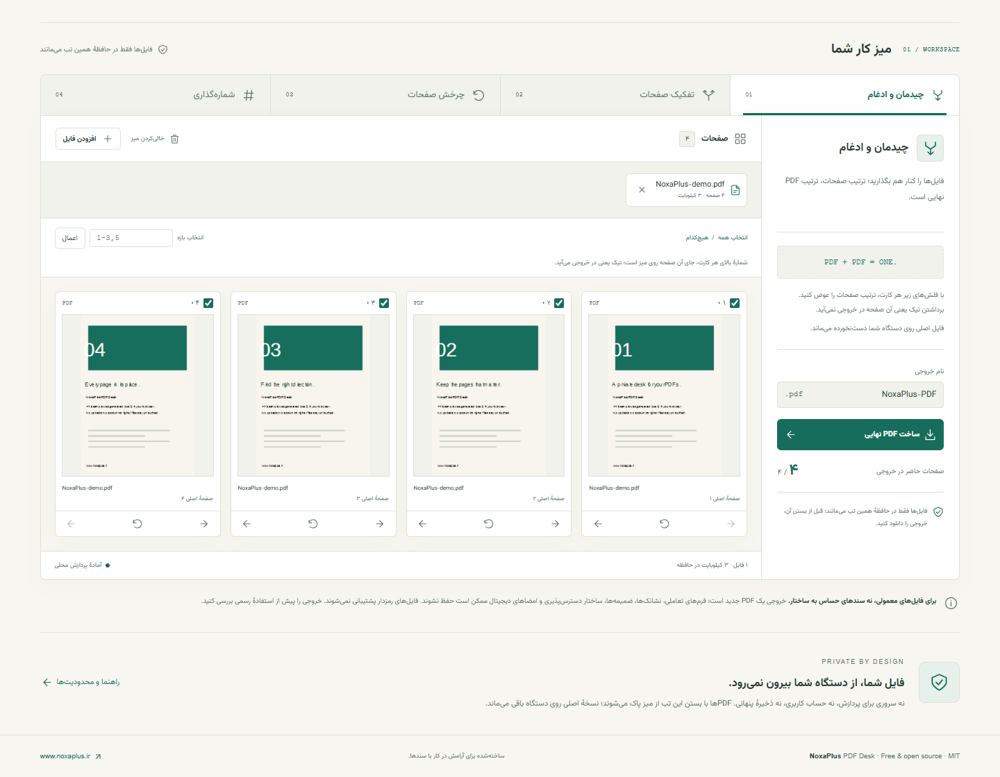
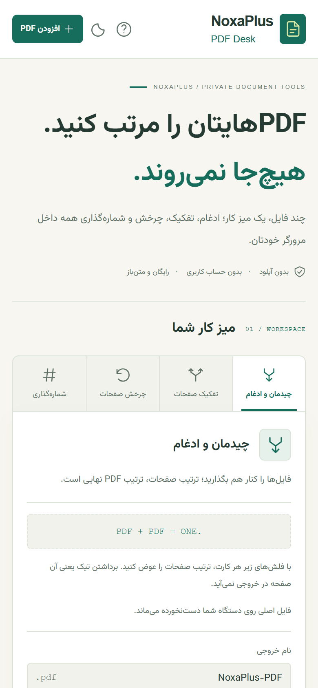

# NoxaPlus PDF Desk

A private, local-first PDF workspace with a Persian, right-to-left interface. Merge, arrange, split, rotate, and number pages in your browser without uploading your documents or creating an account.

**Version:** 1.0.1 · **Release date:** November 13, 2026 · **Project code:** MIT

[Live app](https://noxaplus-star.github.io/noxaplus-pdf-desk/) · [GitHub repository](https://github.com/noxaplus-star/noxaplus-pdf-desk) · [Official NoxaPlus website](https://www.noxaplus.ir)

> Your workspace lives only in memory. Creating an output does not save it: download your PDFs or ZIP before closing or reloading the tab. Original files remain unchanged.

## Features

- **Merge and arrange:** combine included pages from multiple PDFs into one new PDF, in workspace order. Move pages with the card arrows and exclude pages with their checkboxes.
- **Split:** create one PDF per included page, or separate PDFs from custom, disjoint page groups. Download individual PDFs or all outputs in a ZIP.
- **Rotate:** apply quarter-turn adjustments to individual pages, or rotate all included pages in the rotation tool. Existing PDF rotation is preserved and the workspace adjustment is added to it.
- **Number:** add Persian or Latin digits, a custom starting number, six positions, and plain or `number / count` labels. Optionally leave the first output page unnumbered as a cover.
- **Preview:** inspect input-page thumbnails and a larger preview, including rotation adjustments. Added numbering appears only in the final PDF, not on input cards.
- **Local workflow:** drag-and-drop import, a locally generated demo, light/dark themes, progress, and cancellation between processing stages.

The application interface is Persian RTL; this repository documentation is English. The project is a client-side application, not a hosted PDF-processing service. The package is marked private to prevent accidental npm publication.

## Open the app

### Hosted web app

Open [the live app](https://noxaplus-star.github.io/noxaplus-pdf-desk/). The web version uses a service worker to cache the application shell for offline use after a successful online load and cache installation. Offline availability depends on the browser retaining that cache; PDF documents are never included in it.

### Standalone HTML

The production build generates **root `index.html`**, an embedded application intended to open directly through `file://`, without a server or internet connection. Download the actual built HTML rather than a GitHub page displaying its source.

Application JavaScript, CSS, libraries, fonts, and PDF preview resources are embedded. PDF.js runs in a Blob-backed module worker with embedded character maps, standard fonts, and image decoders. There are no runtime CDN dependencies for document processing.

**`app/index.html` is the development entry**, not the standalone deliverable. Service-worker installation is a web-only feature and is not used for `file://`.

### Browser expectations

The application targets modern Chromium-based browsers, including Microsoft Edge. The 1.0.0 release was smoke-tested in Google Chrome at desktop and mobile viewport sizes, and through the standalone `file://` build: import, thumbnails, merge, split and ZIP packaging, rotation, numbering, downloads, theme switching, and service-worker installation were exercised. This is functional release testing, not a formal compatibility certification for every Chromium version. Support for Firefox, Safari, older browsers, or every mobile environment is not claimed.

A modern browser must support module workers, Blob URLs, WebAssembly, and local file downloads. Keyboard navigation and accessible controls are implemented, but no independent accessibility audit or conformance certification is claimed.

## Using the workspace

1. Add PDFs with the file picker or drop them onto the workspace. New files append their pages to the end. An invalid or cancelled import batch leaves the previous workspace unchanged.
2. Arrange pages with the arrows. A checked page is included in output; unchecking does not delete it from the workspace or original file.
3. Choose a tool and configure its options. Only the numbering tool adds number labels; ordering, inclusion, and rotation adjustments apply when creating outputs in any tool.
4. Set an output name and create the output. Open the output dialog, download individual PDFs or the combined download, and verify the downloaded files in a PDF viewer.

Downloads are handed to your browser. Check its downloads folder or prompts; a download request is not proof that a file was successfully saved.

### Page selection versus split groups

The number above an input card is its **current workspace position**, not its original source-page number and not a newly drawn PDF label.

- The selection field, such as `1-3,5`, addresses all current workspace cards and replaces the inclusion selection. Persian and Arabic-Indic digits are also accepted.
- Split groups address only the **included pages, in their current order**, numbered from 1. Separate groups with semicolons, Persian semicolons, or newlines; use commas and ascending ranges within each group.
- Groups must be nonempty and must not overlap. Pages outside all groups are not exported. Within a group, pages follow workspace order, not the order in which numbers were typed.

For example, if workspace cards 2, 4, and 5 are included, split expression `1-2;3` creates one PDF containing cards 2 and 4 and another containing card 5. It does not refer directly to cards 1, 2, and 3.

### Rotation

The final rotation is the existing source rotation plus the workspace quarter-turn adjustment, normalized to 0°, 90°, 180°, or 270°. Resetting workspace rotations removes only your adjustments; it does not erase the original PDF rotation.

### Numbering details

- Starting number: integer **1–999999**. Font size: **8–36 pt**. Margin: **8–72 pt**. One PDF point is 1/72 inch.
- Labels can be placed at the top or bottom, aligned left, center, or right. Margins are measured from the visible page region: the intersection of the crop box and media box, accounting for offsets and final rotation.
- Number text is positioned to remain upright in the rotated page view. Pages too small for the chosen label and margins are rejected; reduce the size or margin.
- Labels are added over existing content; old page numbers are not removed. Cards and enlarged previews show the input page and its rotation, not the numbering overlay.
- If the cover is skipped, the first output page remains unnumbered and the second starts at the chosen starting number. The skipped cover does not consume that number.
- Fraction labels count output pages eligible for numbering, excluding a skipped cover. A custom start changes the numerator, **not** the count: four output pages starting at 10 show `10 / 4` through `13 / 4`; skipping the cover gives an unnumbered cover, then `10 / 3` through `12 / 3`.

## Limits

Limits apply per workspace or export operation, not just to checked cards.

| Resource | Limit |
| --- | --- |
| Each input PDF | 50 MiB |
| Combined input bytes | 150 MiB |
| Input files | 30 |
| Workspace pages, including excluded pages | 300 |
| Split PDF outputs per operation | 100 |
| Combined generated PDF bytes per operation | 200 MiB |

MiB means 1,048,576 bytes. The output limit is the sum of saved PDFs, not a separate ZIP-size limit. ZIP packaging adds overhead and uses uncompressed entries. Actual memory use can exceed input/output sizes because parsers, rendered pages, and buffers also consume memory. Work in smaller batches on constrained devices.

## Supported documents and important limitations

Input validation requires a PDF header at the beginning and a final `%%EOF` terminator followed only by permitted whitespace, plus supported page geometry, rotations, and content references. Encrypted, corrupt, truncated, or unsupported/nonstandard PDFs are rejected; this is intentionally stricter than viewers that repair damaged files.

There is **no password unlocking, OCR, PDF compression, text editing, or redaction**. Image-only PDFs can be arranged like other supported PDFs, but their text is not recognized.

Outputs are new PDFs built from copied pages, not an in-place edit or a rasterized thumbnail export. Preservation of **digital signatures, PDF/A compliance, interactive forms, bookmarks, attachments, or tagged accessibility is not guaranteed**. New output metadata is written. Validate results before legal, archival, printing, or other structure-sensitive use.

Annotations are omitted from thumbnails and enlarged input previews. Preview failure alone does not establish that an input is invalid, and a successful preview does not prove complete fidelity or output safety.

> **This is not a PDF sanitizer.** Downloaded PDFs remain untrusted, source-derived files. Local processing and strict input checks do not guarantee removal of links, actions, annotations, or other potentially unsafe source content. Open outputs in an updated viewer and apply your normal document-security policy.

## Privacy and offline behavior

- PDF bytes, file names, page order, selections, and generated outputs remain in the tab's memory; the app does not upload them or persist them in browser storage.
- **Only the light/dark theme preference is stored** in local storage, under `noxaplus-pdf-desk-theme`.
- The hosted PWA caches application-shell resources only, never your PDFs. That shell cache is separate from the theme preference and the memory-only workspace.
- Closing, reloading, or clearing the workspace discards its in-memory work. There is no automatic recovery, background saving, or cloud backup.
- Original local files are never overwritten or deleted by workspace operations. Browser downloads create separate files.
- Brand links open only when clicked. Visiting the hosted site still involves ordinary hosting requests; opening external links or saving a download is outside the app's in-memory processing boundary.

Local-first processing is not a guarantee against browser extensions, operating-system compromise, malicious source files, or modified app builds. See [SECURITY.md](SECURITY.md) for the threat boundary and private reporting instructions.

## Development

Use **Node.js 22.13 or newer** and npm. No backend, credentials, or environment secrets are required.

```sh
git clone https://github.com/noxaplus-star/noxaplus-pdf-desk.git
cd noxaplus-pdf-desk
npm ci
npm run dev
```

Open the URL printed by Vite. The development server uses `app/index.html`; use the production build to exercise the embedded standalone path.

| Command | Purpose |
| --- | --- |
| `npm ci` | Install dependencies from the committed lockfile |
| `npm run dev` | Start the Vite development server |
| `npm test` | Run the Vitest suite once |
| `npm run test:watch` | Run tests in watch mode |
| `npm run typecheck` | Check TypeScript without emitting files |
| `npm run build` | Type-check, build embedded HTML, and synchronize standalone release artifacts |
| `npm run preview` | Serve the production `dist/` build locally |
| `npm run icons` | Generate application icons through the project script |

The production build emits `dist/index.html` and synchronizes the root standalone `index.html`. Third-party license notices are embedded during the build and supplied separately in `dist/THIRD-PARTY-LICENSES.txt`. Keep notices with redistributed builds.

### Architecture

```text
app/index.html                 Development HTML entry
src/App.tsx                    Persian RTL UI and in-memory workspace orchestration
src/core/model.ts              Page model, limits, ranges, labels, filename rules
src/core/pdf.ts                Strict import checks and PDF creation/number geometry
src/core/*.test.ts             Model and real-PDF regression tests
src/preview.ts                 Embedded PDF.js worker/resources and preview lifecycle
src/components/                Icons, modal dialogs, and page previews
src/fonts.ts                   Embedded Vazirmatn interface fonts
src/download.ts                Blob-based PDF and ZIP download handoff
src/styles.css                 Responsive light/dark interface styles
public/                        Web-shell assets, service worker, and PWA metadata
scripts/                       Icon generation and standalone build synchronization
vite.config.ts                 Development root and HTML asset inlining
index.html                     Generated standalone app; do not hand-edit
dist/                          Generated production distribution
docs/                          Generated screenshots
```

PDF creation uses `pdf-lib` and `@pdf-lib/fontkit`; previews use **PDF.js (`pdfjs-dist`) pinned to 6.5.438**; ZIP packaging uses `fflate`. React, TypeScript, Vite, and Vitest provide the interface, build, and test tooling. PDF.js upgrades require reviewing the embedded worker's decoder-import adaptation, not just changing a version string.

### Tests and contributions

The automated suite covers ranges and disjoint groups, limits, real-PDF validation, selected-page order, original rotation plus adjustments, embedded Persian digits, numbering geometry, output naming, progress, and cancellation. It does not substitute for browser, offline, download, or accessibility testing.

Before committing, run `npm test`, `npm run typecheck`, and `npm run build`, then manually check both the served build and root HTML through `file://`. See [CONTRIBUTING.md](CONTRIBUTING.md) for the focused checklist and [CODE_OF_CONDUCT.md](CODE_OF_CONDUCT.md) for participation expectations.

## Screenshot

Desktop and mobile screenshots are generated at `docs/desktop.png` and `docs/mobile.png` as part of release preparation; screenshots are illustrative, not evidence of compatibility certification.





## License and contact

NoxaPlus-authored project code is licensed under the [MIT License](LICENSE). This does **not** relicense dependencies: PDF.js is Apache-2.0, Vazirmatn fonts use the SIL Open Font License, and other libraries/assets retain their own licenses and required notices. Consult the notices embedded in the built HTML and `dist/THIRD-PARTY-LICENSES.txt` for the actual distributed components.

- Official website: **https://www.noxaplus.ir**
- Email and private security contact: **NoxaPlus2025@gmail.com**
- Release history: [CHANGELOG.md](CHANGELOG.md)
